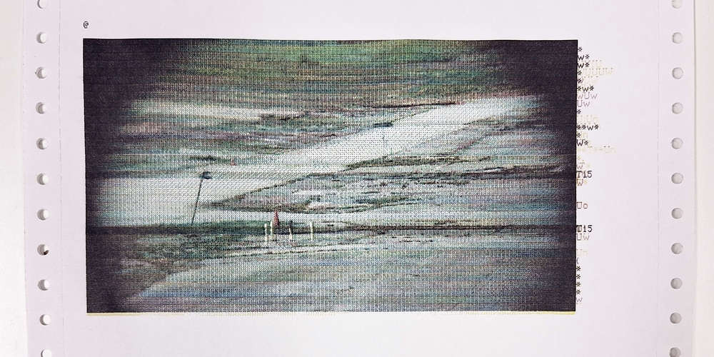
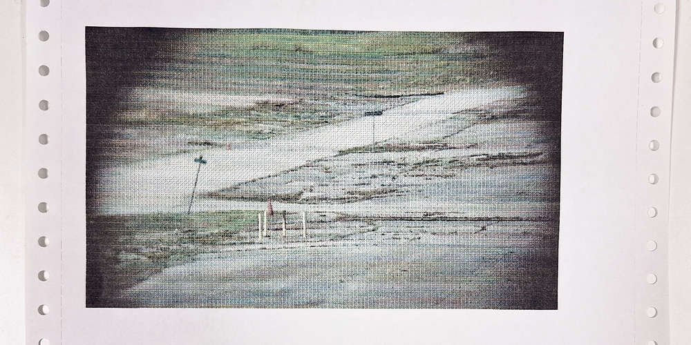

# ImageWriterSender

This is a simple serial sender for sending preprocessed ImageWriter output via an attached PL2303 USB serial adapter on Linux. 

It may also work with other platforms or adapters.

Tested platforms:
- Linux kernel 6.19.14

Tested serial adapters:
- PL2303-based

## Why use it?

It is possible to pipe files directly to the ImageWriter via the serial device, using `stty` to configure flow control. However, I have found that this method injects stray characters and skips lines sometimes.

Here is a before-and-after showing a raw serial-device print (using `stty -F /dev/ttyUSB0 9600 crtscts cs8 -cstopb -parenb`) versus this Python sender on the same machine:

### Stray characters, skipped carriage returns, skipped lines (using raw serial port)



### No stray characters (using ImageWriterSender)



## Usage

```
python3 iwsend.py [RawImageWriterStream.iwhic]

usage: iwsend.py [-h] [-b BAUD] [-d DEVICE] [-t TIMEOUT] filename
```

### Parameters

`-b 1200, 2400, 9600` - Baud/bit rate. Set this to match your [DIP switch settings on the ImageWriter SW2 block](https://www.nefec.org/upm/printers/mapiw2.htm).

`-d /dev/ttyUSB0` - Specify the exact terminal device to open. Typically /dev/ttyUSB0, but could be ttyACM0, ttyAMA0, ttyS0, others

`-t 10` - Timeout for reads from the printer. But we don't read from the printer so it doesn't matter. 

`[filename]` - This must be a preprocessed serial stream ready for the ImageWriter. See below.


## Generating the serial stream

You can send raw text files to the printer just fine--as long as they're ASCII. But you may be interested in sending graphics. Here's how to do that.

### Color graphics

Ghostscript 10.08.0 or newer includes a new `iwhic` color driver for ImageWriter II. You'll need a working color ribbon; mine came from MacEffects.

[Learn about the driver here.](http://press.jmoyer.nodomain.net/gdevadmp/)

Once you've got GhostScript 10.08.0 or newer up and running, here's a general workflow:

- Use a GUI application to generate a PDF of the appropriate size, up to 8.5in wide. This is a hard limit. It must be exactly at or under 8.5in. 
- Use gs to generate a raw ImageWriter stream and save it to a file: `gs -sDEVICE=iwhic -o OUTFILE.iwhic INFILE.pdf`
- Use this repo's `iwsend.py` to send the stream to the printer: `python3 iwsend.py OUTFILE.iwhic`

### B&W graphics

A black-and-white ImageWriter driver, `iwhi`, is available in most installs of GhostScript.

Here's a general workflow:

- Use a GUI application to generate a PDF of the appropriate size, up to 8.5in wide. This is a hard limit. It must be exactly at or under 8.5in. 
- Use gs to generate a raw ImageWriter stream and save it to a file: `gs -sDEVICE=iwhi -o OUTFILE.iwhi INFILE.pdf`
- Use this repo's `iwsend.py` to send the stream to the printer: `python3 iwsend.py OUTFILE.iwhi`


## Backstory

I wrote this simple script as part of my practitioner-in-residence period at the [Media Archaeology Lab](https://www.mediaarchaeologylab.com).


## License

ImageWriterSender is released under the terms of the [Filthy Human Hands (FHH) Licence v1.0](https://whirling.top/fhh/).
